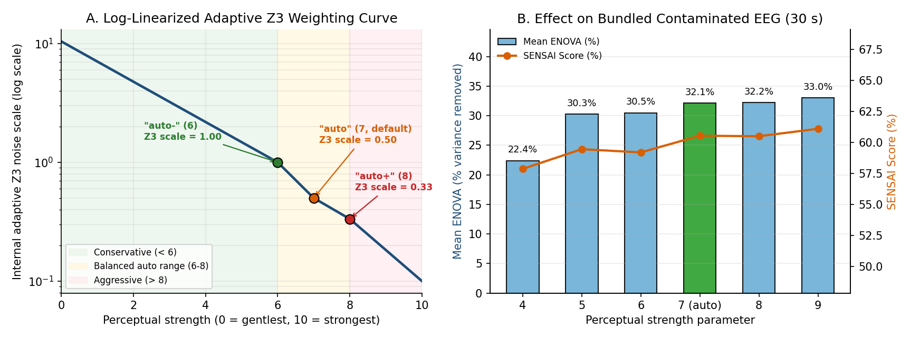
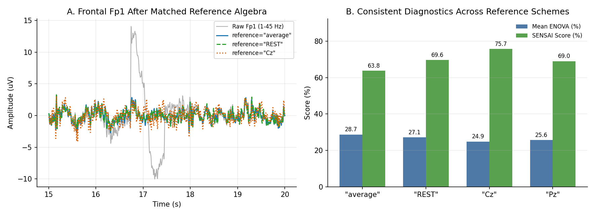
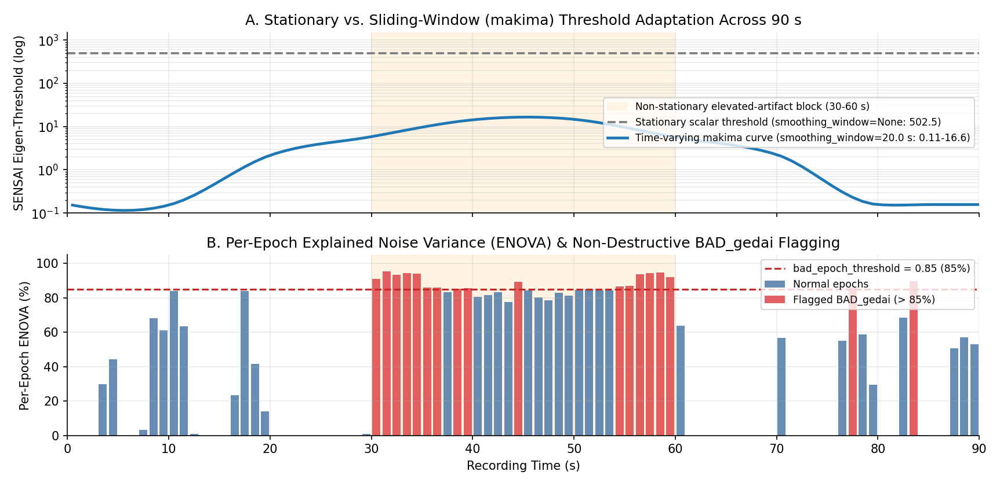
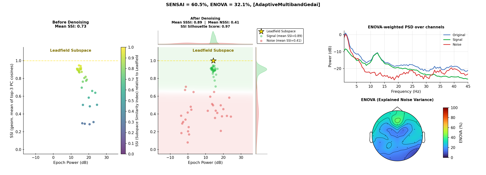

.. _faq:
.. include:: ./links.inc

FAQ & Hyperparameter Guide
==========================

This guide explains **when and why to adjust each GEDAI hyperparameter** by
recording type and analysis goal. For full parameter signatures and return
types, see the :ref:`API Reference <gedai>`.

.. contents:: On this page
   :local:
   :depth: 2

Quick-Start Recipes by Experiment Type
--------------------------------------

For most datasets, default parameters work out of the box. Override only the
parameters relevant to your experimental setup:

.. list-table::
   :header-rows: 1
   :widths: 28 38 34

   * - Use Case
     - Recommended Settings
     - Why It Matters
   * - **General offline EEG / MEG**
     - :class:`~gedai.gedai.AdaptiveMultibandGedai` with
       ``strength="auto"``, ``wavelet_low_cutoff=0.1``,
       ``bad_channel_threshold="auto"``
     - Cycle-adaptive wavelets allocate longer windows to slow bands while
       ``"auto"`` (``7.0``) adapts rejection from GEVD spectral invariants.
   * - **Pre-stimulus ERPs (CNV, RP, LPP)**
     - ``wavelet_low_cutoff=0.0`` (or ``None``) in ``fit_raw``
     - Disables internal wavelet high-pass filtering (global channel mean
       centering only) for zero acausal baseline leakage across stimulus onset.
   * - **Resting EEG with heavy slow sweat / movement drift**
     - ``wavelet_low_cutoff=0.5`` (or ``"auto"`` if already filtered above
       ``0.5 Hz``)
     - Applies sub-cutoff pre-filtering and zeroes spectral bands up to
       ``0.5 Hz`` that would otherwise dominate covariance estimates.
   * - **Long non-stationary recordings (sleep, epilepsy, fatigue)**
     - ``smoothing_window=30.0`` to ``60.0`` (seconds) on ``fit_raw``
     - Adapts GEVD/SENSAI thresholds smoothly across state transitions via
       overlapping calibration windows and Akima (``makima``) interpolation.
   * - **Clinical / BIDS labels, custom 3D montages, or individual MRI**
     - Keep ``reference_cov="leadfield"``, or pass a custom
       :class:`mne.Forward` (or ``"projection"``)
     - Matches BIDS/EDF/legacy labels safely, falls back automatically to 3D
       dipole-kernel projection for non-10-20 channels, or uses subject anatomy.
   * - **Specific EEG reference scheme**
     - ``reference="REST"``, ``"M1+M2"``, ``"TP9+TP10"``, ``"Cz"``, or
       ``"none"``
     - Re-references both the EEG signal and reference covariance identically
       before subspace fitting and restoration.
   * - **Low-latency online / real-time streaming**
     - :class:`~gedai.gedai.MultibandGedai` with ``broadband_pass=False``,
       ``compute_metrics=False``, ``engine="torch"``
     - Fixed-window Haar decomposition pairs with sliding WOLA buffering and
       skips post-hoc ENOVA/SENSAI scoring in tight streaming loops.
   * - **High-density EEG or MEG / OPM arrays**
     - Set ``picks="eeg"``, ``"mag"``, or ``"grad"`` separately; tune
       ``GEDAI_CHANNEL_MULTIPLIER`` if needed
     - Guarantees full-rank covariances via ``min_samples >= k * n_channels``
       and tunes ``n_pc="auto"`` per sensor physics.

Choosing a Model Class
----------------------

- :class:`~gedai.gedai.AdaptiveMultibandGedai` (**recommended offline default**):
  Adjusts epoch duration per wavelet band using ``cycles_per_wavelet`` so slow
  oscillations (delta/theta) span enough cycles for stable covariance estimates
  while fast bands remain short and localized. Supports continuous ``Raw`` data.
- :class:`~gedai.gedai.MultibandGedai`:
  Uses a fixed ``duration`` across all Haar MODWT wavelet levels. Required for
  pre-epoched data (``fit_epochs`` / ``transform_epochs``) when using multiband
  cleaning, or when mirroring fixed-window streaming pipelines.
- :class:`~gedai.gedai.Gedai`:
  Single broadband GEVD spatial filter. Fastest to fit, ideal for teaching,
  quick inspection, or spatially stationary broadband artifacts.

Denoising Strength & SENSAI Optimization
----------------------------------------

``strength`` (``"auto"`` default; ``0``-``10`` perceptual scale)
~~~~~~~~~~~~~~~~~~~~~~~~~~~~~~~~~~~~~~~~~~~~~~~~~~~~~~~~~~~~~~~~

Controls the balance between **artifact suppression** and **neural signal
preservation** in the SENSAI objective (higher = stronger cleaning), matching
MATLAB GEDAI's log-linearized adaptive Z3 spectral weighting curve:

- ``strength="auto"`` (**default**, equivalent to ``7.0``): Balanced adaptive Z3
  denoising computed in closed form from GEVD spectral invariants (scale
  ``0.5``) while automatically protecting rank-1 and rank-2 dipolar cortical
  activity on EEG.
- ``strength="auto-"`` (equivalent to ``6.0``): Conservative adaptive Z3
  denoising (scale ``1.0``). Useful for clean recordings or subtle ERP
  components where preserving weak cortical variance is paramount.
- ``strength="auto+"`` (equivalent to ``8.0``): Aggressive adaptive Z3
  denoising (scale ``1/3``). Useful for heavily contaminated muscle/motion or
  clinical datasets where residual artifacts persist under ``"auto"``.
- **Any float or int in** ``[0, 10]`` (e.g., ``strength=7.5`` or
  ``strength=9.0``): Continuously tunes rejection strength smoothly across
  ``0.0`` (gentlest cleaning) up to ``10.0`` (maximum cleaning).

   Left: Perceptual ``strength`` (``0``-``10``) mapped to the internal
   closed-form adaptive Z3 noise weighting scale, highlighting
   ``"auto-"`` (``6``), ``"auto"`` (``7``, default), and ``"auto+"``
   (``8``). Right: Monotonic effect on ``Mean ENOVA (%)`` and ``SENSAI``
   score over 30 s of the bundled contaminated EEG.

``sensai_method`` (``"optimize"`` default) & ``sensai_tol`` (``0.1``)
~~~~~~~~~~~~~~~~~~~~~~~~~~~~~~~~~~~~~~~~~~~~~~~~~~~~~~~~~~~~~~~~~~~~~

- ``sensai_method="optimize"`` (**default**): Uses continuous bounded scalar
  minimization (fast, smooth threshold selection).
- ``sensai_method="gridsearch"``: Exhaustively evaluates a discrete threshold
  grid over ``sensai_bounds`` (default ``(-6.0, 12.0)`` on
  :class:`~gedai.gedai.Gedai`). Useful mainly for diagnostic score curves or
  verifying non-convex multi-modal landscapes.
- ``sensai_tol`` (default ``0.1``): Convergence tolerance (``xatol``) for
  ``"optimize"``. Lower to e.g. ``0.01`` if fine threshold reproducibility is
  more important than fit speed.

Spatial Prior & Head Model
--------------------------

``reference_cov`` (``"leadfield"`` default)
~~~~~~~~~~~~~~~~~~~~~~~~~~~~~~~~~~~~~~~~~~~

Defines the spatial topography of valid neural brain sources:

- ``"leadfield"`` (**default**): Loads GEDAI's bundled 343-channel ``fsaverage``
  OpenMEEG BEM leadfield covariance. Channel matching strips BIDS/EDF/BioSemi
  prefixes/suffixes safely (e.g., ``"EEG Fp1-REF"``, ``"C3-M2"``, and legacy
  10-20 aliases ``T3``/``T4``/``T5``/``T6``). If any channel is non-10-20
  (e.g., ``"E1"`` or ``"EEG 001"``) and valid 3D coordinates are present in
  ``info``, GEDAI **automatically** uses 3D cortical dipole-kernel projection.
- ``"projection"``: Forces explicit 3D dipole-kernel projection via
  :func:`~gedai.covariance.compute_covariance_from_dipole_projection` and
  :func:`~gedai.covariance.project_leadfield_dipole` from digitized 3D channel
  locations, even if standard 10-20 names are present.
- :class:`mne.Forward`: Pass an individual subject MRI forward model (or pre-built
  BEM/MEG forward). GEDAI computes the covariance via
  :func:`~gedai.covariance.compute_covariance_from_forward` with matching EEG
  referencing. Always prefer this for non-standard infant heads, surgical
  cohorts, or custom MEG/OPM sensor geometries.
- :class:`mne.Covariance`: Pass any custom empirical or synthetic spatial prior
  covariance directly.

``n_pc`` (``"auto"`` default)
~~~~~~~~~~~~~~~~~~~~~~~~~~~~~

Number of leading eigenvectors retained when scoring SENSAI subspace similarity:

- For **EEG**: Resolves automatically to ``3`` (rank-normalized 3D volumetric
  dipolar basis).
- For **MEG**: Prescans the GEVD eigenvalue spectrum to pick ``2`` or ``3``
  components automatically depending on room-noise harmonics vs. dipolar
  bursts. Override with an integer only when benchmarking custom priors.

EEG Referencing
---------------

``reference`` (``"average"`` default; ignored for MEG)
~~~~~~~~~~~~~~~~~~~~~~~~~~~~~~~~~~~~~~~~~~~~~~~~~~~~~~

GEDAI applies the **exact same reference algebra** to both the EEG time series
and the leadfield/reference covariance so spatial subspaces stay consistent:

- ``"average"`` (**default**): Common average reference (recommended for most
  standard workflows and source-informed priors).
- ``"REST"``: Reference Electrode Standardization Technique (infinity reference).
  Requires a physical leadfield or :class:`mne.Forward`. Ideal for functional
  connectivity, scalp topography amplitude accuracy, or sparse asymmetric caps.
- **Linked mastoids / earlobes or single electrode**: Pass ``"M1+M2"``,
  ``"TP9+TP10"``, ``"A1+A2"``, or any electrode name (e.g., ``"Cz"``). Supports
  external 10-05 references not recorded in the EEG data channels as well as
  in-montage electrodes.
- ``"none"``: Disables re-referencing inside GEDAI. Use only if your pipeline
  already applied a specialized reference and you supply an identically
  referenced custom covariance (or call
  :func:`~gedai.covariance.compute_covariance_from_forward` with
  ``reference=None``).

.. note::
   **Flat recording reference protection & noisy reference fallback:** When
   ``bad_channel_threshold`` is active and your online recording reference
   channel (e.g., ``"Cz"``) is still in the montage as all zeros (``0 uV``),
   passing ``reference="Cz"`` protects it from being dropped as a broken flat
   channel (recorded in ``flat_reference_channels_``). Conversely, if a chosen
   reference electrode (e.g., ``M1`` in ``"M1+M2"``) is detected as noisy, GEDAI
   logs a warning and falls back safely to ``"average"``.

   Because GEDAI transforms both the EEG data and leadfield covariance with
   identical linear reference algebra, frontal blink removal (left) and
   overall SENSAI / ENOVA metrics (right) remain consistent across
   ``"average"``, ``"REST"``, ``"Cz"``, and ``"Pz"`` schemes.

Bad Channels & Bad Epochs
-------------------------

``on_bad_channel`` (``"exclude"`` default) & ``bad_channel_threshold`` (``None``)
~~~~~~~~~~~~~~~~~~~~~~~~~~~~~~~~~~~~~~~~~~~~~~~~~~~~~~~~~~~~~~~~~~~~~~~~~~~~~~~~~

- ``on_bad_channel="exclude"`` (**default**): Respects channels marked in
  ``inst.info["bads"]``, excluding them from spatial decomposition and average
  referencing, and raises an error if a fitted channel is later marked bad at
  transform time. Pass ``"ignore"`` only to retain legacy pre-0.7.0 behavior.
- ``bad_channel_threshold``: Enables MATLAB-style automatic two-pass detection.
  A pre-pass detects broken flat channels and Pass 1 fits GEDAI to identify
  channels whose per-channel ENOVA exceeds the threshold (``"auto"`` uses
  ``0.95``, or pass a float in ``(0, 1]``); Pass 2 then refits cleanly on the
  remaining good channels. Recommended for unattended batch pipelines.
- ``interpolate_bads`` (``False`` default on ``transform_raw`` /
  ``transform_epochs``): Set to ``True`` to reconstruct excluded bad channels
  with MNE spherical spline interpolation and re-apply EEG referencing on the
  restored montage (requires valid 3D channel locations).

``bad_epoch_threshold`` (``None`` default)
~~~~~~~~~~~~~~~~~~~~~~~~~~~~~~~~~~~~~~~~~~

Set e.g. ``bad_epoch_threshold=0.85`` on ``transform_raw`` or
``transform_epochs`` to flag residual extreme-ENOVA 1-second windows (where more
than 85% of variance had to be removed, typically mechanical cap hits or wire
pops). On ``Raw``, GEDAI non-destructively adds ``"BAD_gedai"`` MNE annotations
and populates boolean ``bad_epochs_`` without deleting samples.

``reject_by_annotation`` (``False`` default)
~~~~~~~~~~~~~~~~~~~~~~~~~~~~~~~~~~~~~~~~~~~~

Keep this ``False`` during ``fit_raw``. Because GEDAI is an unsupervised noise
subspace learner, it *needs* to observe representative blinks, EMG bursts, and
electrode pops in order to isolate and subtract them accurately.

Wavelet Bands & Window Geometry
-------------------------------

``wavelet_low_cutoff`` (``0.1`` default)
~~~~~~~~~~~~~~~~~~~~~~~~~~~~~~~~~~~~~~~~

Controls both low-frequency pre-filtering on ``Raw`` and spectral subband
exclusion on :class:`~gedai.gedai.MultibandGedai` and
:class:`~gedai.gedai.AdaptiveMultibandGedai` (on :class:`~gedai.gedai.Gedai`,
``highpass_prefilter=0.1`` plays the corresponding role):

- ``0.1`` (**default**): Applies a 0.1 Hz Haar wavelet high-pass pre-filter
  before broadband estimation while keeping the 0.1-0.5 Hz scaling band
  spatially cleaned. Best general-purpose choice.
- ``0.0`` or ``None``: Applies global channel mean centering only (no wavelet
  high-pass filtering) and cleans all bands down to DC. Essential for
  **slow cortical potentials and anticipatory ERPs** (CNV, Readiness Potential,
  LPP) or when a causal filter was already applied upstream.
- ``>= 0.5`` (e.g., ``0.5``): Stronger slow-drift pre-filtering; subbands with
  upper frequency bound ``<= wavelet_low_cutoff`` are zeroed out. Useful for
  severely drifting eyes-open/motion resting-state EEG.
- ``"auto"``: Reads ``raw.info["highpass"]`` and resolves to
  ``max(0.1, raw.info["highpass"])``.

``wavelet_level`` (``"auto"``), ``cycles_per_wavelet`` (``10``), ``broadband_pass`` (``True``)
~~~~~~~~~~~~~~~~~~~~~~~~~~~~~~~~~~~~~~~~~~~~~~~~~~~~~~~~~~~~~~~~~~~~~~~~~~~~~~~~~~~~~~~~~~~~~~

- ``wavelet_level="auto"`` (**default**): Automatically selects decomposition
  depth based on ``sfreq`` so wavelet detail bands span physiological rhythms
  down to ``0.5 Hz``.
- ``cycles_per_wavelet`` (default ``10`` on
  :class:`~gedai.gedai.AdaptiveMultibandGedai`): Targets at least N cycles per
  wavelet band's lower cutoff frequency when choosing adaptive calibration epoch
  durations. Increase slightly (e.g., ``12``) when clean stationary segments are
  plentiful; decrease (e.g., ``6``-``8``) on very short recordings.
- ``broadband_pass=True`` (**default**): Runs a fast initial broadband GEDAI pass
  before multiband fitting to prevent giant transient jumps from skewing
  band-level GEVD decompositions. Keep ``True`` offline; set ``False`` for
  single-stage low-latency streaming or specialized synthetic tests.

``duration`` (``1.0`` s) & ``overlap`` (``0.5``)
~~~~~~~~~~~~~~~~~~~~~~~~~~~~~~~~~~~~~~~~~~~~~~~~

- ``duration``: Calibration and transform epoch length (in seconds) for
  :class:`~gedai.gedai.Gedai` and :class:`~gedai.gedai.MultibandGedai`. Note
  that GEDAI automatically enforces at least ``k * n_channels`` samples per
  covariance window (default ``k = 1.0``, configurable via environment variable
  ``GEDAI_CHANNEL_MULTIPLIER``) so high-density arrays never suffer rank-deficient
  covariance matrices.
- ``overlap`` (default ``0.5``): Fractional overlap (in ``[0, 1)``) between
  consecutive cosine-tapered dual-stream windows. Increase to ``0.75`` only if
  you observe boundary discontinuities during heavy burst transitions.

Non-Stationary Long Recordings
------------------------------

``smoothing_window`` (``None`` default on ``fit_raw``)
~~~~~~~~~~~~~~~~~~~~~~~~~~~~~~~~~~~~~~~~~~~~~~~~~~~~~~

Use ``smoothing_window`` for **long recordings with non-stationary background
EEG signal** (such as full-night **sleep** architecture shifts, **epilepsy**
ictal/interictal transitions, **fatigue / drowsiness** blocks, or multi-hour
ICU/neurofeedback sessions):

- ``None`` or ``np.inf`` (**default**): Fits a single stationary threshold across
  the entire recording (best when recording state and noise characteristics are
  roughly stable, or when transferring a fitted model to new sessions).
- **Positive float in seconds** (e.g., ``30.0`` or ``60.0``): Divides the
  recording into 50% overlapping calibration windows of length
  ``smoothing_window``, solves local SENSAI and adaptive Z3 thresholds per
  window, and interpolates a smooth per-epoch threshold curve across time using
  modified Akima (``makima``) interpolation.

.. note::
   When ``transform_raw`` is called on the fitted recording, it applies the full
   time-varying curve (stored internally in ``_fit["threshold_curve"]``). If you
   later apply the model to a recording with a different epoch count, GEDAI logs
   a message and falls back cleanly to the median scalar threshold.

   Top: Stationary scalar threshold (``smoothing_window=None``) vs.
   time-varying modified Akima (``makima``) threshold curve
   (``smoothing_window=20.0`` s) adapting across a heavy 30-60 s artifact
   block (log scale). Bottom: Per-epoch ENOVA (%) with
   ``bad_epoch_threshold=0.85`` non-destructively flagging extreme burst
   windows as ``BAD_gedai`` epochs.

Compute Performance, Units & Quality Diagnostics
------------------------------------------------

``engine`` (``"auto"``), ``n_jobs`` (``None``), & ``compute_metrics`` (``True``)
~~~~~~~~~~~~~~~~~~~~~~~~~~~~~~~~~~~~~~~~~~~~~~~~~~~~~~~~~~~~~~~~~~~~~~~~~~~~~~~~

- ``engine="auto"`` (**default**): Uses vectorized PyTorch CPU linear algebra
  whenever ``torch`` is installed, and falls back to NumPy otherwise (producing
  mathematically equivalent results). Override with ``"numpy"`` or ``"torch"``
  only for benchmarking or reproducibility checks.
- ``n_jobs``: Parallel workers across bands/grid steps (``None``/``1`` serial;
  ``-1`` uses all CPU cores). Prefer ``n_jobs=1`` with ``engine="torch"``
  because PyTorch already multi-threads internally and avoids joblib worker
  overhead.
- ``compute_metrics`` (default ``True``): Populates ``metrics_`` (``ENOVA`` per
  epoch/channel, ``mean_enova``, composite ``sensai_score``) after transform.
  Set ``compute_metrics=False`` in low-latency real-time loops.

Amplitude Units & Interpreting Goodness-of-Fit Metrics
~~~~~~~~~~~~~~~~~~~~~~~~~~~~~~~~~~~~~~~~~~~~~~~~~~~~~~

- **Amplitude scale invariance**: MNE-Python uses SI units (Volts for EEG,
  Tesla or Tesla/m for MEG), and GEDAI trace-matches the reference covariance to
  the data so cleaning results are invariant to uniform unit scaling (Volts vs.
  microvolts).
- **ENOVA** (``metrics_["mean_enova"]``): Fraction of signal variance removed as
  noise (``0%`` = untouched, higher on noisy segments; near ``0-10%`` on clean
  resting EEG).
- **SENSAI goodness-of-fit** (``fit_metrics_["sensai_score"]`` &
  ``plot_sensai``): Checks whether retained brain data match the chosen spatial
  prior (``SSSI`` / ``ssi_after_mean``, high -> neural patterns preserved)
  while removed noise diverges from it (``NSSI`` / ``ssi_noise_mean``, low ->
  artifacts cleanly separated). Use ``plot_sensai`` whenever evaluating a
  custom head model or unusual montage.

   Default 3-column output of ``plot_sensai`` on 30 s of contaminated EEG:
   raw (left) and separated Signal/Noise (middle) in Subspace Similarity
   Index (SSI) vs. Epoch Power space, ENOVA-weighted Welch PSD (top right),
   and per-channel ENOVA scalp topography (bottom right).
